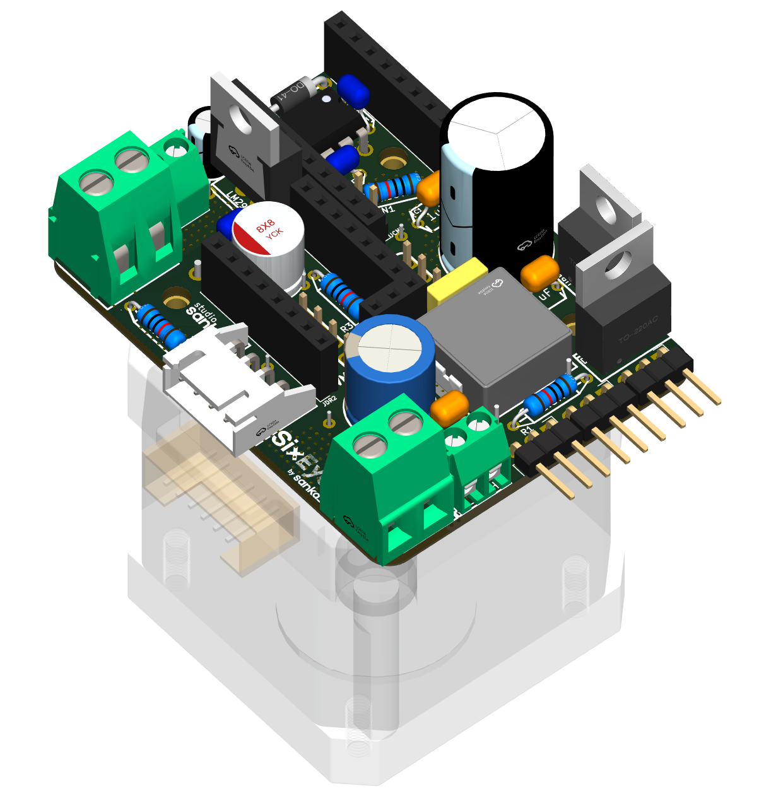
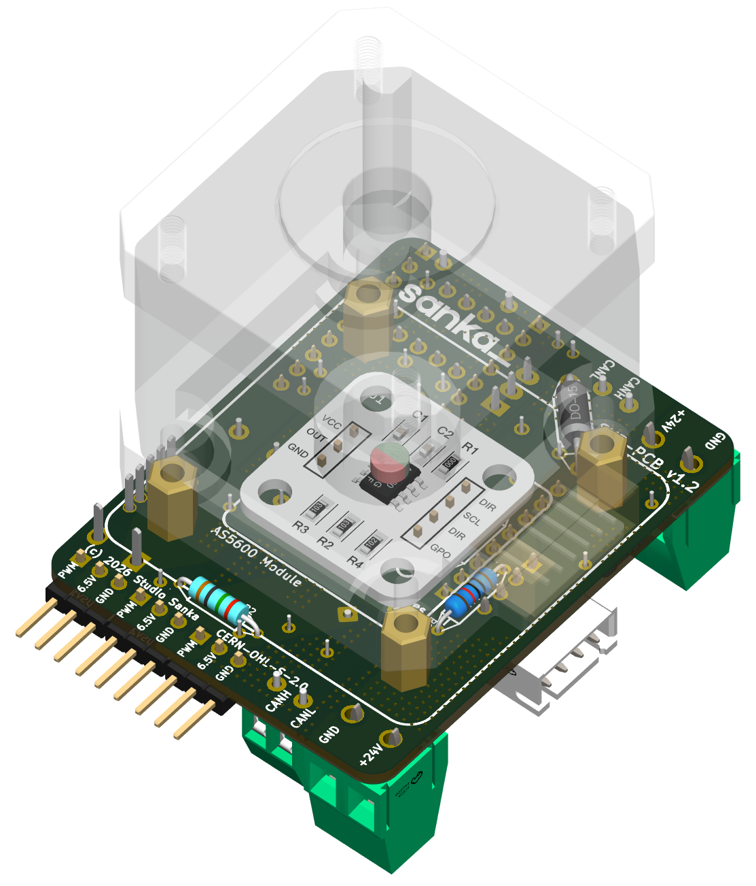

# 6. Assemble and test

**Status: draft.** Some of this is written from the design only, because the mechanical parts are not published and the firmware does not move the motor yet. Each step says what is real and what is still to come.

Read the safety rules in [Build the PCB](04-build-the-pcb.md) first. They apply here too.

## 1. Mount the motor

| Front | Back |
|:-:|:-:|
|  |  |

*3D renders of the joint board on a NEMA 17 motor (the motor is drawn transparent). Left: the front. Right: the back, with the AS5600 encoder module and the four standoffs that carry the motor. The Super Mini and TMC2209 modules are not shown in their sockets.*

1. The board carries the motor on **four M3×8 brass standoffs** (the circles marked SO1 to SO4). Screw them into place with M3×14 screws and **0.5 mm washers**.
2. The motor sits on top of the standoffs. Its rear face is about **9.5 mm** above the board. An ordinary single-shaft motor works: the magnet goes on the **rear shaft end**, which is visible through the opening in the back cover, so no dual-shaft motor is needed. How deep that shaft end sits sets the gap to the encoder chip (see the [design reference §6](reference/v1.2_PCB_Design_Reference.md)). These numbers are from the design and have **not been checked on a real motor yet**.
3. Fit the **magnet** (diametrically magnetised, about 6 × 2 to 3 mm) centred on the rear shaft end, **0.5 to 3 mm** from the AS5600 chip. The magnet's north and south must sit side by side across the chip, not top and bottom.

## 2. Connect the motor and wires

**With the power off:**

1. **Motor:** plug the motor lead into the JST connector **JDR3**. If the motor turns the wrong way later, that is fixed in software, not by re-wiring.
2. **24 V in:** the **JPW1** screw terminal. Check the ⊖ and ⊕ marks before you wire it.
3. **CAN:** the **JCN1 / JCN2** terminals, H to H and L to L along the chain.
4. **Termination:** fit the jumper on **JCN3** on the **Base and Elbow boards only**, the two ends of the bus.
5. **Fuse:** the inline fuse stays in the 24 V wire, always.

## 3. First tests

1. **USB only first.** Plug in USB without the 24 V supply. The board must start and print the boot messages.
2. **Then power** with the fuse in and, if you have one, a bench supply limited to **0.5 A**. Flash and check **"TMC2209 on UART: ok"** (see [Flash the firmware](05-flash-the-firmware.md)). The driver needs the 24 V (VM) to answer.
3. **Check the encoder:** the firmware reads the AS5600. Turning the motor shaft by hand should change the reading. This depends on the magnet being the right distance.
4. **Run current:** it starts at **500 mA RMS**. Never raise it above your motor's rated current (a generic 40 mm NEMA17 is about 1.5 A). Raise it in small steps and check the driver stays cool.

## 4. Moving the motor

**Not available yet.** The step generation and homing are not written in the joint firmware. The standalone test rig showed that the driver and motor run, but that is separate test code. This section will be written when the joint firmware can move the motor.

## If something goes wrong

- **Smell, smoke or a hot part:** switch off at the supply first.
- **"UART not answering":** see the checklist in [Flash the firmware](05-flash-the-firmware.md).
- **The motor hums but doesn't turn:** switch off. Check the four motor wires and the coil pairs with a meter (coil 1 on JDR3 pins 1 and 2, coil 2 on pins 3 and 4).

## Related

- [PCB design reference](reference/v1.2_PCB_Design_Reference.md)
- [TMC2209 modules: what we tried and learned](reference/tmc2209-modules.md)
