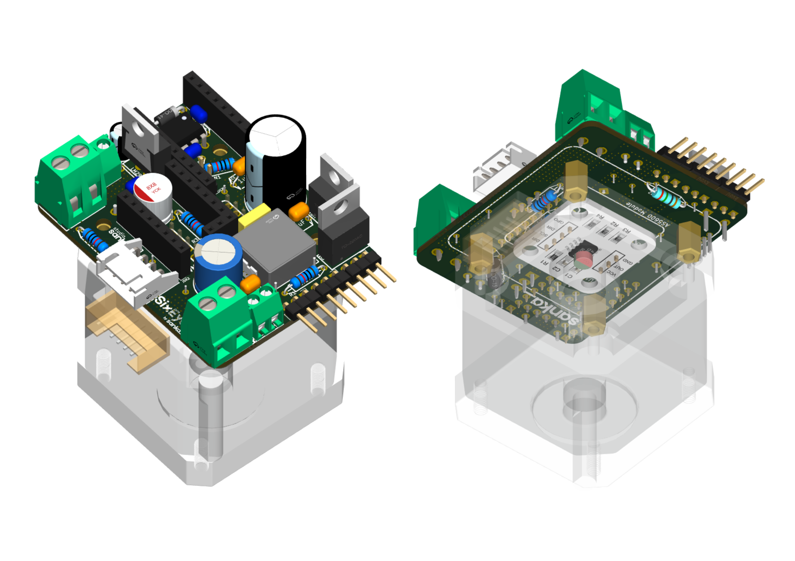

# Hardware

Everything needed to build the electronics and the mechanics of the arm.

*3D render of the joint board on a NEMA 17 motor (the motor is drawn transparent). Left: the front. Right: the back, with the AS5600 encoder module and the four standoffs that carry the motor. The Super Mini and TMC2209 modules are not shown in their sockets.*

| Folder | What is in it | Status |
|---|---|---|
| [`pcb/kicad/`](pcb/kicad/) | KiCad project for the joint board (open `SixEyes_v1.2.kicad_pro`) | layout in progress |
| [`pcb/libraries/`](pcb/libraries/) | Symbols, footprints and 3D models the project uses (nothing to install) | ready |
| [`pcb/bom/`](pcb/bom/) | Bill of materials with LCSC part numbers | ready (v1.2) |
| [`pcb/drawings/`](pcb/drawings/) | Signed schematic and layout plots (PDF), v1.2 | ready |
| [`pcb/gerbers/`](pcb/gerbers/) | Files to send to a PCB manufacturer | ready (v1.2) |
| [`mechanical/stl/`](mechanical/stl/) | 3D-printable parts | coming soon |
| [`tools/`](tools/) | Scripts that generate the custom KiCad parts | for maintainers |

Open the KiCad project with KiCad 10. The project finds its libraries relative to itself.

The circuit is explained in the [PCB design reference](../docs/reference/v1.2_PCB_Design_Reference.md).

## A note on the tight placement

The components on this board are packed very tightly, and in a few places parts slightly overlap. That is deliberate: the aim was a small board that sits on the back of a NEMA 17 motor, made only of through-hole parts a beginner can solder, and kept neat. KiCad's courtyard checks are switched off for that reason, while every other check (clearance, shorts, hole spacing, edge distance, our own power and CAN rules) is clean. We are sorry if it makes review harder, and we hope you understand. See the [design reference](../docs/reference/v1.2_PCB_Design_Reference.md) for details.

## Licence

Hardware designs are licensed under CERN-OHL-S-2.0, see [LICENSE](LICENSE).
